<h1>Olá 👋! Eu sou o Estevão Kenji</h1>

  
<h3>Contato</h3>
  

  

<h3>Habilidades</h3> 

  <picture>
    <source
      media="(prefers-color-scheme: dark)"
      srcset="https://github.com/estevaokenji/estevaokenji/blob/output/github-snake-dark.svg">
    
  </picture>

